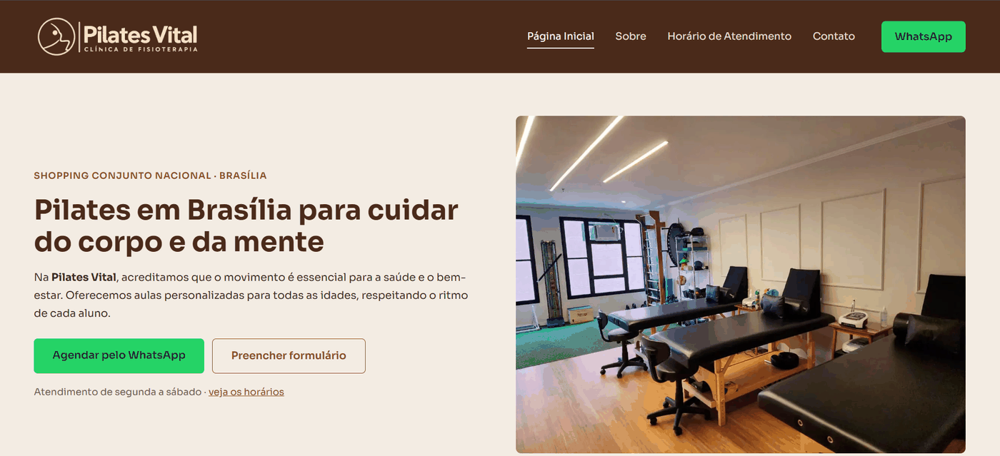

# Pilates Vital

Site institucional para um estúdio de pilates, desenvolvido com HTML, CSS e um pouco de JavaScript. O projeto nasceu como um desafio do curso Formação HTML Web Developer e foi refeito depois, com foco em layout, acessibilidade e responsividade.

🔗 **Site no ar:** _(link do GitHub Pages)_



## Páginas

- **Página Inicial:** apresentação do estúdio e depoimento de aluna.
- **Sobre:** valores da clínica e tipos de pilates oferecidos.
- **Horário de Atendimento:** tabela de horários por serviço e explicação de cada modalidade.
- **Contato:** endereço, mapa e formulário de contato.

## Tecnologias

- HTML5 semântico (`header`, `nav`, `main`, `footer`)
- CSS3 com variáveis de cor, Flexbox e Grid
- JavaScript puro, usado só no menu lateral

## Decisões do projeto

- **Menu lateral na direita**, escondido atrás de um botão. Fecha com o botão ×, clicando fora dele ou com a tecla `Esc`, e tem `aria-expanded` e foco gerenciado para teclado e leitores de tela.
- **Responsivo:** o layout se adapta a computador, tablet e celular, sem rolagem horizontal.
- **Paleta definida em variáveis CSS** (`:root`), baseada na cor da logo, o que facilita mudar o tema.
- **Imagens otimizadas:** a foto do depoimento foi reduzida de 2,2 MB para cerca de 160 KB.

## Estrutura

```
├── index.html
├── sobre.html
├── horario.html
├── contato.html
├── css/base.css
├── js/menu.js
└── img/
```

## Como rodar localmente

```bash
git clone https://github.com/Ianisaque/clinica-fisioterapia-html.git
cd clinica-fisioterapia-html
```

Abra o `index.html` no navegador ou use a extensão Live Server no VS Code.

## Autor

**Ian Isaque Rabêlo Barros**  
[GitHub](https://github.com/Ianisaque)